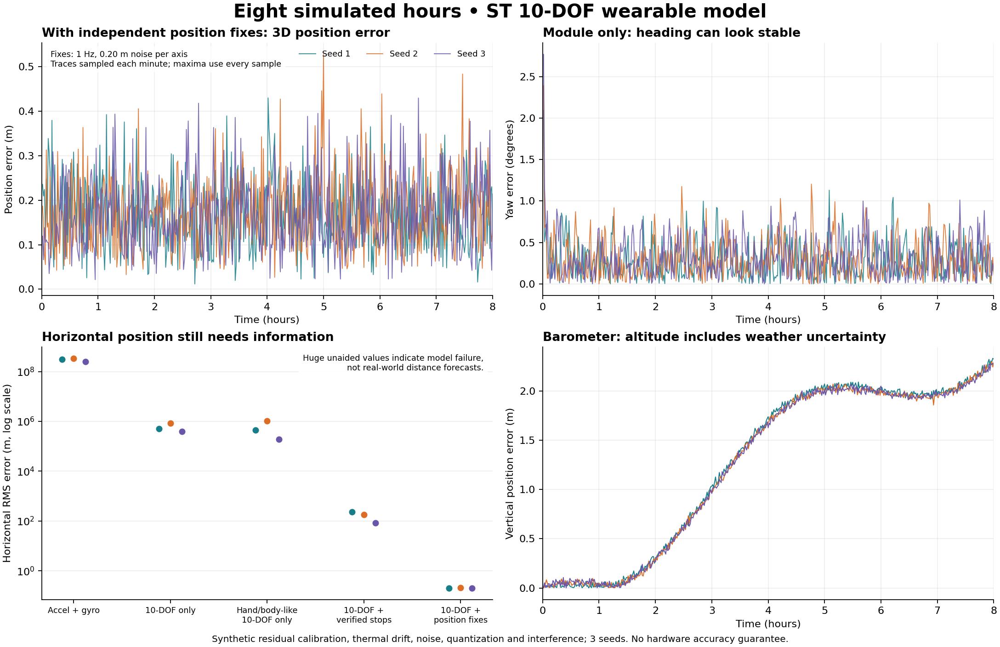

# Eight-hour model results

These results use the actual C++ implementation and the synthetic ST sensor profile described in [the simulation methodology](../simulation/README.md). They are not measured hardware performance or a proof of minimum error. Each range spans three random seeds. Full source hashes and commands are in the [manifest](../simulation/results/manifest.json).



| Scenario | Final 3D error, m | RMS 3D error, m | Worst sample error, m | 3σ XYZ coverage |
|---|---:|---:|---:|---:|
| Stationary, verified rest (6-axis) | 0.02335–0.03469 | 0.01552–0.03064 | 0.04477 | 100% |
| Stop/go, verified rest (6-axis) | 118.3–417.8 | 114.2–309.1 | 590.6 | 73–99.98% |
| Continuous, accel + gyro only | 7.645e+08–1.299e+09 | 3.077e+08–5.313e+08 | 1.299e+09 | 100% |
| 6-axis + position at 1 Hz | 0.1154–0.1248 | 0.2458–0.2469 | 1.166 | 99.23–99.34% |
| 6-axis + position, outages/outliers | 0.1154–0.1248 | 2.223–3.063 | 121 | 99.24–99.35% |
| 10-DOF module only | 8.248e+05–1.334e+06 | 3.937e+05–8.498e+05 | 1.336e+06 | 100% |
| 10-DOF + verified full stops | 69.44–330.7 | 85.11–228.8 | 431.4 | 94.47–99.9% |
| 10-DOF + position at 1 Hz | 0.1176–0.2142 | 0.2119–0.2138 | 0.8408 | 99.44–99.52% |
| Hand/body-like motion, 10-DOF only | 9.82e+04–1.779e+06 | 1.925e+05–1.049e+06 | 1.803e+06 | 100% |

## Held-out noise realizations

Seeds 4–6 were run after freezing the model and priors. They vary noise under the same trajectory and systematic-error assumptions; they are not new hardware or new environments.

| Scenario | Final 3D error, m | RMS 3D error, m | 3σ XYZ coverage |
|---|---:|---:|---:|
| 10-DOF module only | 8.198e+05–1.555e+06 | 4.112e+05–8.898e+05 | 100% |
| Hand/body-like, 10-DOF only | 6.209e+05–6.934e+05 | 3.018e+05–3.636e+05 | 100% |
| 10-DOF + independent position at 1 Hz | 0.1449–0.2297 | 0.2108–0.2134 | 99.42–99.5% |

## Why persistent magnetic uncertainty matters

The paired continuous-motion experiments retain identical inertial/noise streams. Earlier candidates were selected using seeds 1–3, so this is a development ablation. Full per-seed results and provenance are in [model_comparison.csv](../simulation/results/model_comparison.csv) and [its metadata](../simulation/results/model_comparison.json). The archive contains the final core; intermediate source snapshots are identified by hashes in the metadata.

| Error states | Magnetic calibration residuals | 3σ XYZ coverage | Final yaw error, deg |
|---:|---|---:|---:|
| 16 | Included | 0.4738–0.5613% | 0.321–0.5439 |
| 16 | Removed (ablation) | 100% | 0.08479–0.1436 |
| 19 | Included | 2.01–5.152% | 0.0396–0.2656 |
| 19 | Removed (ablation) | 100% | 0.1266–0.1785 |
| 25 | Included | 100% | 0.118–0.1802 |
| 25 | Removed (ablation) | 100% | 0.1241–0.1744 |

The 16-state candidate treats residual magnetic calibration as white noise. The 19-state candidate adds persistent offset uncertainty. The final 25-state model also retains symmetric scale/cross-axis uncertainty. Improved coverage means the filter better represents uncertainty in this model; it does not make the divergent horizontal position useful. A 100% sample coverage result is not a certified error bound.

## Interpretation

- The module measures acceleration, angular velocity, magnetic field and pressure. It does not provide independent horizontal position. Continuous unaided horizontal estimates diverge in this experiment. Their very large numerical errors are failure indicators outside the meaningful local-frame regime.
- Magnetometer and barometer corrections can improve heading and height while horizontal position still fails. A stable-looking compass is not evidence of accurate coordinates.
- The position-aided case assumes an additional independent source at 1 Hz with Gaussian 0.20 m per-axis noise. This capability is not supplied by the four chips on the user’s module.
- Verified-stop cases receive independent knowledge of true rigid rest. A hand or torso during walking must not receive a foot-contact zero-velocity flag. The walking-like synthetic route does not receive one.
- Coverage measures model consistency on correlated synthetic samples, not a probability guarantee. Persistent unmodeled magnetic, pressure or calibration errors can violate the reported covariance.
- Initial position, velocity, orientation and the magnetic/Earth reference are favorably known in the model. Actual alignment, gyro scale, clock delay, vibration and sensor timing have not been measured.
- Path length and final position error are separate metrics. This filter sums predicted displacement magnitudes; corrections do not retroactively repair accumulated distance.

## Reproduce

```sh
python3 simulation/run_benchmark.py --sensitivity
python3 simulation/plot_results.py
```

The plotting command requires Matplotlib. The estimator, tests and benchmark require a C++17 compiler, Make and Python; the numerical C++ implementation has no third-party matrix library dependency.

See [hardware commissioning](HARDWARE.md), [mathematical derivation](MATHEMATICS.md), and [validation requirements](VALIDATION_PLAN.md) before interpreting these results as an engineering error budget.
